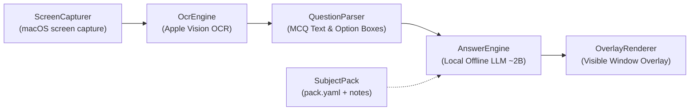

# netPrep

**netPrep** is an open-source macOS menu-bar assistant designed to help students practice and review multiple-choice questions (MCQs) in real-time.

It captures quiz questions from the screen, processes them through optical character recognition (OCR), reasons over domain-specific hints using a lightweight offline local LLM (~2B parameters), and renders the suggested answer letter (A–D) in a clear, visible overlay on screen.

netPrep is completely **subject-agnostic**: all core pipeline stages are domain-neutral, allowing any educational domain (e.g. computer networks, operating systems, algorithms) to be added purely as data without altering code.

---

## Architecture & Pipeline



### Subject Separation Rule
Only the `AnswerEngine` stage is permitted to access or load the `SubjectPack`. All upstream stages (`ScreenCapturer`, `OcrEngine`, `QuestionParser`) and downstream stages (`OverlayRenderer`) are strictly subject-neutral.

---

## Design Rule: Transparent, Visible Overlay Only

> **Important**: The answer overlay is a normal, visible window. Under no circumstances will netPrep include or accept features intended to hide, disguise, or obscure the overlay or application windows from screen sharing, proctoring, or recording software.

---

## macOS Setup & Installation

### Requirements
- macOS 13 (Ventura) or newer
- Python 3.11, 3.12, or 3.13 (Python 3.12 recommended; Python 3.14+ lacks prebuilt PySide6 universal2 wheels)

### Installation
```bash
# If needed, install Python 3.12 via Homebrew
brew install python@3.12

# Clone the repository
git clone https://github.com/your-username/netprep.git
cd netprep

# Create and activate a virtual environment with Python 3.12
/opt/homebrew/bin/python3.12 -m venv .venv
source .venv/bin/activate

# Install dependencies (installs PySide6-Essentials, pynput, PyYAML, pytest)
pip install -r requirements.txt
```

### macOS System Permissions
Global hotkey detection across other applications requires macOS Accessibility and Input Monitoring permissions:
1. Open **System Settings** > **Privacy & Security**.
2. Select **Accessibility** and ensure your terminal emulator (e.g. Terminal, iTerm2, VS Code) or Python is granted access.
3. Select **Input Monitoring** and verify access is enabled.

*If permissions are not yet granted, netPrep will warn you upon startup instead of crashing, and allow triggering scans directly from the menu-bar tray item.*

---

## Running the Application

Start the macOS menu-bar tray application:
```bash
python -m netprep.app
```

### Menu-Bar Controls
- **Scan now**: Manually triggers a capture and answer cycle.
- **Pause hotkey / Resume hotkey**: Toggles global hotkey responsiveness.
- **Subject**: Submenu listing all discovered subject packs in `subjects/`. Clicking any subject immediately switches the active domain context.
- **Quit**: Gracefully shuts down hotkey listeners and exits the application.

---

## Adding a New Subject Pack

New subjects are loaded dynamically from the `subjects/` directory as data, requiring zero code modifications:

1. Create a new folder inside `subjects/`, e.g. `subjects/operating_systems/`:
   ```text
   subjects/
   └── operating_systems/
       ├── pack.yaml
       ├── notes/
       │   └── .gitkeep
       └── eval/
           └── questions.json
   ```

2. Define `pack.yaml`:
   ```yaml
   name: "Operating Systems"
   description: "Process scheduling, virtual memory, concurrency, and file systems."
   prompt_hint: "Focus on deadlock conditions, page replacement algorithms, and CPU scheduling policies."
   ```

3. Add notes to `notes/` for retrieval and context grounding.

4. Provide evaluation benchmark questions in `eval/questions.json`:
   ```json
   [
     {
       "id": 1,
       "question": "Which scheduling algorithm is non-preemptive and selects the process with the smallest burst time?",
       "options": {
         "A": "Round Robin",
         "B": "Shortest Job First (SJF)",
         "C": "Priority Preemptive",
         "D": "Multi-Level Feedback Queue"
       },
       "answer": "B"
     }
   ]
   ```

---

## Running the Evaluation Benchmark

Run benchmark evaluations against an answer engine with detailed accuracy and latency reporting:

```bash
python scripts/run_eval.py --subject computer_networks --engine dummy
```

### Evaluation Output Format
The evaluator validates:
- Exactly four options (A, B, C, D)
- Answer is one of the four options
- Unique integer/string IDs across all questions

The report outputs:
- Overall accuracy percentage and ratio
- Average processing latency per question (in ms)
- List of incorrect questions with expected vs. predicted letters
- Invalid answer counter (empty answers or multiple options)

---

## Running Tests

Run the full test suite using `pytest` or Python's standard library `unittest`:
```bash
# Using pytest
pytest

# Using standard library unittest
python3 -m unittest discover tests -v
```

---

## Roadmap

- [x] Package structure and configuration loader
- [x] Abstract pipeline interfaces and stub implementations
- [x] Subject pack discovery and dynamic tray submenu
- [x] Global hotkey listener with macOS permission diagnostics
- [x] Evaluation runner with schema validation
- [ ] Screen capture engine using CoreGraphics / Quartz
- [ ] Apple Vision framework OCR integration
- [ ] Local offline LLM integration (~2B parameters via Ollama or llama.cpp)
- [ ] Visual overlay window with PySide6
- [ ] Local notes RAG context retrieval

---

## License

This project is licensed under the [MIT License](LICENSE).
# netPrep
