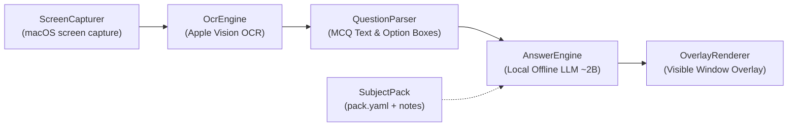

# netPrep

**netPrep** is an open-source macOS menu-bar assistant designed to help students practice and review multiple-choice questions (MCQs) in real-time.

It captures quiz questions from the screen, processes them through optical character recognition (OCR), reasons over domain-specific hints using a lightweight offline local LLM (~2B parameters), and renders the suggested answer letter (A–D) in a clear, visible overlay on screen.

netPrep is completely **subject-agnostic**: all core pipeline stages are domain-neutral, allowing any educational domain (e.g. computer networks, operating systems, algorithms) to be added purely as data without altering code.

---

## Architecture & Pipeline



### Subject Separation Rule
Only the `AnswerEngine` stage is permitted to access or load the `SubjectPack`. All upstream stages (`ScreenCapturer`, `OcrEngine`, `QuestionParser`) and downstream stages (`OverlayRenderer`) are strictly subject-neutral.

---

## Design Rule: Transparent, Visible Overlay Only

> **Important**: The answer overlay is a normal, visible window. Under no circumstances will netPrep include or accept features intended to hide, disguise, or obscure the overlay or application windows from screen sharing, proctoring, or recording software.

---

## macOS Setup & Installation

### Requirements
- macOS 13 (Ventura) or newer
- Python 3.11, 3.12, or 3.13 (Python 3.12 recommended; Python 3.14+ lacks prebuilt PySide6 universal2 wheels)

### Installation
```bash
# If needed, install Python 3.12 via Homebrew
brew install python@3.12

# Clone the repository
git clone https://github.com/your-username/netprep.git
cd netprep

# Create and activate a virtual environment with Python 3.12
/opt/homebrew/bin/python3.12 -m venv .venv
source .venv/bin/activate

# Install dependencies (installs PySide6-Essentials, pynput, PyYAML, pytest)
pip install -r requirements.txt
```

### macOS System Permissions
netPrep requires macOS system permissions for capture and hotkey detection:
1. **Screen Recording**: Required to capture quiz questions from the screen.
   - Open **System Settings** > **Privacy & Security** > **Screen Recording**.
   - Enable your terminal emulator (e.g. Terminal, iTerm2, VS Code) or Python.
2. **Accessibility & Input Monitoring**: Required for global hotkey detection across other applications.
   - Open **System Settings** > **Privacy & Security** > **Accessibility** and **Input Monitoring**.
   - Enable your terminal emulator or Python.

*If permissions are not yet granted, netPrep will warn you upon startup and during scan cycles with step-by-step instructions instead of crashing.*

---

## Screen Capture & OCR Pipeline

netPrep features an in-memory, privacy-preserving capture, OCR, and question-parsing pipeline:

1. **Screen Capture (`netprep/capture.py`)**:
   - Captures the main display or a configured region in-memory as a `CapturedImage` (PNG bytes, pixel dimensions, scale factor, screen point origin).
   - Handles Retina display scale factors ($2\times$ or standard $1\times$) and converts between pixel coordinates and screen points.
   - Completely in-memory: no screenshots or temporary images are written to persistent storage.

2. **Optical Character Recognition (`netprep/ocr.py`)**:
   - Built on Apple's native **Vision framework** (`VNRecognizeTextRequest` via `pyobjc-framework-Vision`).
   - Runs **100% offline** on-device with `VNRequestTextRecognitionLevelAccurate` and language correction enabled.
   - Automatically translates Vision's bottom-left normalized coordinate system $[0.0, 1.0]$ into top-left pixel bounding boxes and screen points.
   - Sorts recognized lines sequentially top-to-bottom.

3. **Question Parsing (`netprep/parser.py`)**:
   - Turns OCR text lines into a structured `ParsedQuestion` with stem text, options A–D, and per-option bounding boxes.
   - Supported option marker formats: `A.`, `A)`, `(A)`, `A:`, and lowercase `a)`.
   - Automatically joins wrapped multi-line question stems and multi-line options, calculating the bounding box union for each choice.
   - Strips top UI noise (timers like `14:59`, counters like `Question 1 of 20`, score badges) and bottom navigation buttons (`Next`, `Submit`, `Mark for Review`).
   - **No guessing**: strictly enforces exactly 4 sequential options (A, B, C, D). If fewer, more, or out-of-order options appear, it raises `QuestionNotFoundError`, logging "No question found" rather than hallucinating.

### Developer Verification Scripts

Developers can verify pipeline stages independently without starting the tray UI:

- **Capture Check**:
  ```bash
  python scripts/capture_check.py [--region x,y,w,h] [--out path.png]
  ```
- **OCR & Question Parser Check**:
  ```bash
  # Check against an image file
  python scripts/ocr_check.py --image path/to/quiz_screenshot.png [--out copy.png]

  # Check against a live screen capture
  python scripts/ocr_check.py --live [--region x,y,w,h]
  ```
- **Answer Engine Check**:
  ```bash
  # Verify with a question on the command line
  python scripts/answer_check.py --question "Which protocol maps IP to MAC?" --a "DNS" --b "ARP" --c "DHCP" --d "BGP" [--engine ollama] [--model qwen2.5:1.5b]

  # Verify with a JSON question file
  python scripts/answer_check.py --file path/to/question.json
  ```
- **Overlay Verification Check**:
  ```bash
  # Check normal option highlight and badge
  python scripts/overlay_demo.py --option B --box 200,320,520,40

  # Check top-center fallback badge (when bounding box is unavailable)
  python scripts/overlay_demo.py --fallback --option A

  # Check visible error message toast
  python scripts/overlay_demo.py --error "No question found"
  ```

---

## Local LLM Setup (Ollama)

netPrep uses a lightweight local large language model (~2B parameters) served by **Ollama** on `http://localhost:11434`.

> **Completely Offline Rule**: netPrep makes zero internet calls at runtime. It talks solely to the local Ollama server running on localhost. Models are downloaded once, at setup time, by the user.

### 1. Install & Start Ollama
```bash
# Install Ollama via Homebrew
brew install ollama

# Start the Ollama server daemon
ollama serve
```

### 2. Pull Recommended Models
Pull one or more supported models in your terminal:
```bash
# Recommended default: Qwen 2.5 1.5B (fast, highly accurate on technical MCQs)
ollama pull qwen2.5:1.5b

# Alternative: Llama 3.2 1B (ultra-lightweight meta model)
ollama pull llama3.2:1b
```

### Supported Models Reference

| Model | Parameters | Size (Disk) | VRAM / RAM | Description |
|---|---|---|---|---|
| `qwen2.5:1.5b` (Default) | 1.5B | ~980 MB | ~1.5 GB | Highly accurate on networking, CS theory, and technical MCQs. |
| `llama3.2:1b` | 1.2B | ~1.3 GB | ~1.8 GB | Fast, lightweight general-purpose model. |
| `qwen2.5:3b` | 3.1B | ~1.9 GB | ~3.0 GB | Higher reasoning capacity for advanced certification questions. |

### Cold vs. Warm Inference Latency
- **Cold Request (First scan)**: On the initial scan after startup, Ollama loads the model weights from disk into memory (~1–2 seconds).
- **Warm Requests (Subsequent scans)**: netPrep uses `keep_alive` ("5m") and preloads the model on startup (`warmup()`). Subsequent scans only incur active generation latency (~100–300 ms on Apple Silicon).

---

## Visual Overlay Renderer (`netprep/overlay.py`)

netPrep includes a lightweight, hardware-accelerated visual overlay built with **PySide6**:

- **Frameless, Transparent & Click-Through**: Covers the screen or captured region without title bars or window borders (`Qt.FramelessWindowHint | Qt.WindowStaysOnTopHint | Qt.WindowTransparentForInput`). Clicks pass through completely to underlying applications (`setAttribute(Qt.WA_TransparentForMouseEvents, True)`).
- **Non-Focusing & Non-Activating**: Runs with `Qt.WindowDoesNotAcceptFocus` and `Qt.WA_ShowWithoutActivating`, preventing keyboard focus theft from browsers, terminals, or test software.
- **Accurate Highlighting & Badging**:
  - Highlights the suggested option with a rounded emerald rectangle (`#10B981`) and a distinct dark boundary outline for high contrast on light and dark backgrounds.
  - Draws a circular letter badge (`A`–`D`) immediately to the left of the option box (or fallback top-left when space is constrained).
- **Fallback Top-Center Badge**: When an option box cannot be determined or falls off-screen, netPrep shows a compact badge at the top-center of the screen with the answer letter.
- **Self-Capture Prevention**: Before screen capture begins, the overlay is hidden and the event loop is flushed (`QApplication.processEvents()`) with a brief buffer sync delay (~50 ms) to ensure the OCR pass never captures the previous answer marker.
- **Thread Safety**: Heavy work (Screen Capture, Apple Vision OCR, Ollama LLM inference) runs in a background daemon thread, keeping the macOS menu-bar and Qt event loop fluid. All overlay updates dispatch safely to the main Qt thread.
- **Status & Error Toast Messages**: Pipeline errors (e.g., *"No question found on screen"*, *"Ollama server offline"*, or *"Invalid answer format"*) appear as an unobtrusive top-center slate banner.
- **Auto-Dismissal & Controls**: The overlay automatically fades after a configurable duration (default 6.0 seconds), resets on the next scan, or can be cleared immediately from the menu-bar tray via **Clear marker**.

> **Visible Overlay Rule (Non-Negotiable)**: The overlay is a normal visible window. Under no circumstances will netPrep implement or accept features intended to hide, disguise, or obscure overlay windows from screen capture, screen recording, proctoring tools, or window lists.

---

## Configuration (`config.yaml`)

Configuration can be customized via `config.yaml`:
```yaml
hotkey: "<ctrl>+<alt>+s"
active_subject: "computer_networks"
capture_region: null   # Optional [x, y, width, height] in screen points (null = full main display)
scan_timeout: 10.0
model_name: "qwen2.5:1.5b"  # or "dummy" for mock testing
ollama_host: "http://localhost:11434"
ollama_timeout: 15.0
ollama_keep_alive: "5m"
overlay_duration: 6.0  # Duration in seconds before overlay automatically dismisses
overlay_highlight_color: "#10B981"
overlay_badge_color: "#059669"
overlay_text_color: "#FFFFFF"
overlay_fallback_position: "top_center"
```

---

## Running the Application

Start the macOS menu-bar tray application:
```bash
python -m netprep.app
```

### Menu-Bar Controls
- **Scan now**: Manually triggers a capture and answer cycle.
- **Clear marker**: Instantly hides any active overlay marker or error toast banner.
- **Pause hotkey / Resume hotkey**: Toggles global hotkey responsiveness.
- **Subject**: Submenu listing all discovered subject packs in `subjects/`. Clicking any subject immediately switches the active domain context.
- **Quit**: Gracefully shuts down hotkey listeners and exits the application.

---

## Adding a New Subject Pack

New subjects are loaded dynamically from the `subjects/` directory as data, requiring zero code modifications:

1. Create a new folder inside `subjects/`, e.g. `subjects/operating_systems/`:
   ```text
   subjects/
   └── operating_systems/
       ├── pack.yaml
       ├── notes/
       │   └── .gitkeep
       └── eval/
           └── questions.json
   ```

2. Define `pack.yaml`:
   ```yaml
   name: "Operating Systems"
   description: "Process scheduling, virtual memory, concurrency, and file systems."
   prompt_hint: "Focus on deadlock conditions, page replacement algorithms, and CPU scheduling policies."
   ```

3. Add notes to `notes/` for retrieval and context grounding.

4. Provide evaluation benchmark questions in `eval/questions.json`:
   ```json
   [
     {
       "id": 1,
       "question": "Which scheduling algorithm is non-preemptive and selects the process with the smallest burst time?",
       "options": {
         "A": "Round Robin",
         "B": "Shortest Job First (SJF)",
         "C": "Priority Preemptive",
         "D": "Multi-Level Feedback Queue"
       },
       "answer": "B"
     }
   ]
   ```

---

## Running the Evaluation Benchmark

Run benchmark evaluations against an answer engine with detailed accuracy, latency percentiles, letter distributions, and model comparisons:

```bash
# 1. Run evaluation with dummy engine
python scripts/run_eval.py --subject computer_networks --engine dummy

# 2. Run evaluation with local Ollama model
python scripts/run_eval.py --subject computer_networks --engine ollama --model qwen2.5:1.5b

# 3. Filter by dataset split (e.g. dev or holdout)
python scripts/run_eval.py --subject computer_networks --engine ollama --model qwen2.5:1.5b --split dev

# 4. Save evaluation summary JSON to docs/reports/eval-results/
python scripts/run_eval.py --subject computer_networks --engine ollama --model qwen2.5:1.5b --save

# 5. Side-by-side comparison between two models
python scripts/run_eval.py --compare qwen2.5:1.5b llama3.2:1b
```

### Evaluation Output Format
The evaluator validates:
- Exactly four options (A, B, C, D)
- Answer is one of the four options
- Unique integer/string IDs across all questions
- Optional `split` (`dev` or `holdout`) and `topic` fields

The report outputs:
- Overall accuracy percentage and ratio
- Per-topic accuracy breakdown (if `topic` field present)
- Average, median (p50), and 95th percentile (p95) latency (in ms)
- Predicted letter distribution across all choices (A–D and Invalid)
- Warning if dataset ground-truth answers are unbalanced (>50% frequency)
- List of incorrect questions with expected vs. predicted letters
- Invalid answer counter (empty answers, unrecognized formats, or multiple letters)

---

## Running Tests

Run the full test suite using `pytest` or Python's standard library `unittest`:
```bash
# Using pytest
pytest

# Using standard library unittest
python3 -m unittest discover tests -v
```

---

## Roadmap

- [x] Package structure and configuration loader
- [x] Abstract pipeline interfaces and stub implementations
- [x] Subject pack discovery and dynamic tray submenu
- [x] Global hotkey listener with macOS permission diagnostics
- [x] Evaluation runner with schema validation
- [x] Screen capture engine (Quartz in-memory capture, Retina coordinate conversions)
- [x] Apple Vision framework OCR and question parser
- [x] Local offline LLM integration (~2B parameters via Ollama)
- [x] Visual overlay window with PySide6
- [ ] Local notes RAG context retrieval

---

## License

This project is licensed under the [MIT License](LICENSE).
